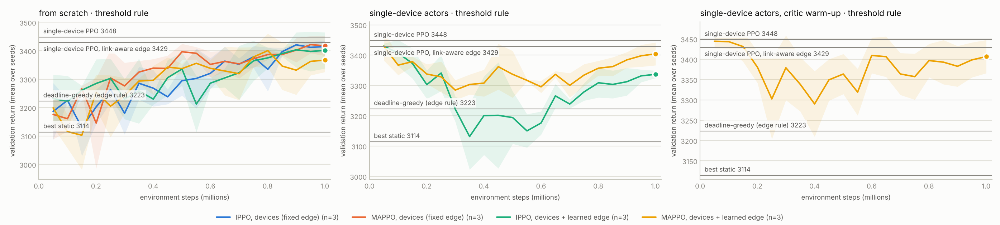

# EdgeArbiter — multi-agent RL for adaptive AI model selection on IoT–edge devices

[](https://github.com/louayakermi2816-gif/edgearbiter/actions/workflows/tests.yml)

Real-time AI on IoT devices has to trade **accuracy against latency, energy and
network quality**: which model to run, how often to sense, and whether to run it
on the device or offload it to an edge server — while the edge server has its
own load to protect. EdgeArbiter studies that decision end to end, **in software
only** (no hardware):

1. **Models and their measured costs** — MobileNetV3-Small/Large and ResNet-18
   trained on Imagenette with a PyTorch pipeline (data loaders, augmentation,
   evaluation), quantised to INT8 (`torch.ao.quantization`), and benchmarked for
   top-1 accuracy, p50/p95 latency and memory on an **emulated low-power device**
   (one CPU-throttled core) and on an edge server, together with torchvision's
   FP32/INT8 zoo and the SSDLite detector. The measurements form the **cost table**
   that drives the simulator.
2. **An IoT–edge simulator**: bursty workload, Markov wireless link with a
   bandwidth-limited uplink, bounded device queue, energy budget, edge server
   with background tenants, latency tails from the measured p95.
3. **Cooperative agents** — a *device* agent (model tier × sensing rate ×
   local/offload) and an *edge* agent (admit × CPU share), trained with
   **independent PPO (IPPO)** and **MAPPO** (centralised critic, decentralised
   execution), against static, rule-based and model-based baselines — on one device,
   and on three and five devices sharing one edge.
4. **The IoT loop** — a **FastAPI** policy service, **MQTT** and a **Node-RED**
   board, fed by a **virtual ESP32 node** (Python, same protocol as the firmware);
   the Arduino firmware itself runs in the **Wokwi** ESP32 simulator.

```
Imagenette ─finetune.py─▶ MobileNetV3-S/L, ResNet-18 ─quantize.py─▶ FP32 + INT8
                                         │
     benchmark.py: emulated device (1 thread @ 0.25 CPU) and edge (4 vCPU)
     top-1 · p50/p95 latency · memory ─▶ cost table ─▶ simulator (sim/env.py) ◀── scenarios
                                                              │
                         baselines (static, rule, greedy) ◀───┼───▶ PPO / IPPO / MAPPO (agents/mappo.py)
                                                              │
virtual ESP32 node / Wokwi ──MQTT──▶ Node-RED ──HTTP──▶ FastAPI /policy/decide ──▶ Node-RED ──MQTT──▶ node
```

## Status (October 2026)

In development since September 2026. Every number below comes from a file in
[`results/`](results/) written by the scripts in this repository.

| Part | State |
|---|---|
| Imagenette training pipeline | done: MobileNetV3-Small 82.6 %, MobileNetV3-Large 83.9 %, ResNet-18 86.7 % top-1, trained from scratch on CPU |
| Benchmark: FP32 / INT8, top-1, p50 / p95, memory; emulated device and edge | done — [device](results/benchmark_device_imagenette.md), [edge](results/benchmark_edge_imagenette.md), torchvision zoo incl. SSDLite ([device](results/benchmark_device_zoo.md), [edge](results/benchmark_edge_zoo.md)) |
| Measured cost table → simulator | done — [results/cost_table.json](results/cost_table.json) (the default table) |
| Simulator, baselines, IPPO / MAPPO, experiment protocol | done, tested (`pytest`, CI) |
| RL study on the measured table (2 scenarios, 3 seeds) | done — [results/experiments.md](results/experiments.md) |
| RL study on the synthetic development table | done — [results/experiments_synthetic.md](results/experiments_synthetic.md) |
| Multi-device studies: 3 and 5 devices sharing one edge (IPPO / MAPPO, learned edge, transfer, fine-tuning) | done — [3 devices](results/fleet.md), [5 devices](results/fleet5.md) |
| Software IoT loop: virtual ESP32 node ↔ MQTT ↔ Node-RED board ↔ FastAPI | run end to end here with the MAPPO actors of the measured study: 150 / 150 decisions answered through Node-RED, mean round trip 12.7 ms; MQTT loop tested in CI |
| Fine-tuning from ImageNet weights; top-1 of the pretrained zoo | code ready; needs download.pytorch.org, not reachable from the build environment |
| ESP32 firmware in Wokwi; Docker stack | files ready; not run here (no Docker; the Arduino / PlatformIO download hosts are blocked) |

## Quick start

```bash
python -m venv .venv && source .venv/bin/activate      # Windows: .venv\Scripts\activate
pip install -r requirements.txt && pip install -e ".[dev,plot,iot]"
pytest -q                                              # simulator, agents, benchmark, training, API, MQTT loop

python scripts/run_baselines.py                        # static / rule-based / greedy baselines
python scripts/run_experiments.py --budget-fraction 0.7 --steps 1000000 --seeds 0 1 2 --workers 4   # ~1 h on 4 cores
python scripts/run_benchmark.py --weights random --no-data --threads 1 4 --tag quick   # zoo latency / memory here
uvicorn edgearbiter.api:app --reload                   # http://127.0.0.1:8000/docs
```

[Reproducing everything](#reproducing-everything) lists the full pipeline, from training to
the board.

## Models and measured costs

### Training on Imagenette

`edgearbiter/finetune.py` trains MobileNetV3-Small, MobileNetV3-Large and ResNet-18 on
Imagenette (10 ImageNet classes, 160 px release, 9,469 training / 3,925 validation images):
random-resized-crop, flip and colour-jitter augmentation, 128 px input, AdamW with a
one-cycle schedule, label smoothing 0.1, validation every epoch and the best checkpoint
kept. The ImageNet weights are not downloadable from the build environment, so all three
are trained **from scratch** (`--from-scratch`); without the flag the same script
fine-tunes from ImageNet weights.

| model | init | epochs | input | best val top-1 | training time |
|---|---|---|---|---|---|
| MobileNetV3-Small | scratch | 20 | 128 px | **82.6 %** | 47 min ([log](results/finetune_mobilenet_v3_small_scratch.md)) |
| MobileNetV3-Large | scratch | 20 | 128 px | **83.9 %** | 122 min ([log](results/finetune_mobilenet_v3_large_scratch.md)) |
| ResNet-18 | scratch | 20 | 128 px | **86.7 %** | 136 min ([log](results/finetune_resnet18_scratch.md)) |

The two larger models were trained at the same time on the 4 vCPUs, hence the longer
times. Both MobileNetV3 models stay at chance level (10 %) for the first two to three
epochs and are unstable while the one-cycle learning rate is near its peak (epochs 4–8);
ResNet-18 reaches 46 % after one epoch and rises steadily.

### FP32 vs INT8 on the device and on the edge

The INT8 models are **post-training static quantisations** (`edgearbiter/quantize.py`:
`torch.ao.quantization`, FX graph mode, x86 engine) calibrated on 512 training images, and
their accuracy is measured on the same validation images as their FP32 parents.

- **Device (emulated)**: the timed inferences run on one thread inside a cgroup limited to
  0.25 CPU (`edgearbiter/cpulimit.py`, the CFS quota behind `docker run --cpus=0.25`) — a
  single slow core.
- **Edge**: this 4-vCPU host, each model at its fastest thread count (1, 2 or 4).
- Each model is measured in a fresh process (`edgearbiter/bench_worker.py`): batch 1,
  200 timed runs after 10 warm-up runs. **Memory** is what the deployed model needs: its
  weights plus the resident memory that running it adds (activations, workspace, kernel
  caches), at its peak over the timed runs.

| model | precision | top-1 | device p50 / p95 | edge p50 / p95 (threads) | memory | weights |
|---|---|---|---|---|---|---|
| MobileNetV3-Small | FP32 | 82.6 % | 55.4 / 75.0 ms | 9.1 / 13.6 ms (1) | 12.2 MB | 6.2 MB |
| MobileNetV3-Small | INT8 (x86, PTQ) | 82.5 % | 60.9 / 85.7 ms | 8.5 / 12.8 ms (2) | 8.5 MB | 1.8 MB |
| MobileNetV3-Large | FP32 | 83.9 % | 100.7 / 137.2 ms | 15.1 / 21.2 ms (4) | 26.7 MB | 17.1 MB |
| MobileNetV3-Large | INT8 (x86, PTQ) | 83.6 % | 78.5 / 109.4 ms | 11.5 / 13.3 ms (2) | 13.3 MB | 4.7 MB |
| ResNet-18 | FP32 | 86.7 % | 146.0 / 191.5 ms | 13.7 / 19.0 ms (4) | 53.0 MB | 44.8 MB |
| ResNet-18 | INT8 (x86, PTQ) | 86.9 % | 40.3 / 56.5 ms | 5.0 / 7.1 ms (4) | 26.1 MB | 11.3 MB |

Measured 2026-10-23 on an Intel Xeon @ 2.80 GHz VM (4 vCPU), torch 2.14.1, 128 px input
([device](results/benchmark_device_imagenette.md), [edge](results/benchmark_edge_imagenette.md)).

- **INT8 keeps the accuracy** (−0.1, −0.3 and +0.2 points), cuts the weights 3.4–4× and
  the memory by 30–50 %.
- **Its speed-up depends on the architecture**: 3.6× for ResNet-18 on the device (146 →
  40 ms), 1.3× for MobileNetV3-Large, and none for MobileNetV3-Small (10 % slower).
- So **after quantisation ResNet-18 is both the most accurate and the fastest model on
  the device**, faster than the FP32 MobileNetV3-Small. The size ladder is no longer a
  latency ladder.
- A quarter of a core makes inference 5–7× slower than an unthrottled thread (the model
  runs in 1.25 ms slices every 5 ms), and p95 is 30–40 % above p50 on the device. The edge
  is 6–11× faster than the device.

### torchvision zoo, including the SSDLite detector

The same measurements for torchvision's architectures at their native resolution, with
random weights (latency and memory do not depend on the weights; accuracy is not
measured): torchvision's own INT8 models are quantised in eager mode for qnnpack
(MobileNetV3-Large) and fbgemm (ResNet-18).

| model | precision | input | device p50 / p95 | edge p50, 1 thread | edge p50, 4 threads | memory | weights |
|---|---|---|---|---|---|---|---|
| mobilenet_v3_small | FP32 | 224 px | 93.1 / 121.1 ms | 13.4 ms | 14.5 ms | 19.8 MB | 10.3 MB |
| mobilenet_v3_large | FP32 | 224 px | 222.9 / 265.0 ms | 37.1 ms | 32.2 ms | 45.3 MB | 22.1 MB |
| mobilenet_v3_large_int8 | INT8 (qnnpack) | 224 px | 199.8 / 255.5 ms | 38.1 ms | 40.2 ms | 19.1 MB | 5.7 MB |
| resnet18 | FP32 | 224 px | 360.4 / 420.5 ms | 72.9 ms | 30.4 ms | 65.8 MB | 46.8 MB |
| resnet18_int8 | INT8 (fbgemm) | 224 px | 120.4 / 160.6 ms | 21.0 ms | 9.6 ms | 18.2 MB | 11.8 MB |
| efficientnet_b0 | FP32 | 224 px | 320.0 / 365.0 ms | 59.1 ms | 36.9 ms | 43.3 MB | 21.4 MB |
| ssdlite320_mobilenet_v3_large | FP32 | 320 px | 702.8 / 856.1 ms | 124.8 ms | 110.0 ms | 55.9 MB | 14.1 MB |

At 224 px the larger compute of ResNet-18 shows again: MobileNetV3-Small is the fastest
classifier on the device, and INT8 ResNet-18 is 3× faster than FP32 ResNet-18 but slower
than MobileNetV3-Small. torchvision's INT8
MobileNetV3-Large, calibrated for ARM (qnnpack), gains little on this x86 host. The SSDLite detector needs 0.7 s per frame on the device and 0.11 s on
the edge: an offload candidate, not a 10 fps device workload.

### From measurements to the cost table

`scripts/run_benchmark.py --tiers deployment --merge <device run> <edge run>` builds
[`results/cost_table.json`](results/cost_table.json): one tier per architecture (tiny =
MobileNetV3-Small, small = MobileNetV3-Large, medium = ResNet-18), each deployed in INT8 if
the INT8 model is faster on the device and loses at most 1 point of top-1, else in FP32 —
a rule fixed before the measurements. Energy per inference is derived from device latency
(0.45 mJ per ms, a crude model until a power meter is used); offloading a 40 KB frame costs
10 mJ of radio energy.

| tier | model | top-1 | device p50 / p95 | edge p50 / p95 | energy / inference | memory |
|---|---|---|---|---|---|---|
| tiny | MobileNetV3-Small FP32 | 82.6 % | 55.4 / 75.0 ms | 9.1 / 13.6 ms | 24.9 mJ | 12.2 MB |
| small | MobileNetV3-Large INT8 | 83.6 % | 78.5 / 109.3 ms | 11.5 / 13.3 ms | 35.3 mJ | 13.3 MB |
| medium | ResNet-18 INT8 | 86.9 % | 40.3 / 56.5 ms | 5.0 / 7.1 ms | 18.1 mJ | 26.1 MB |

The medium tier dominates the other two on the device: it is the most accurate, the
fastest and the cheapest in energy. Locally, the INT8 MobileNetV3-Large misses the 100 ms
deadline on about 1 frame in 9 (its p95 is 109 ms); the other two practically never.

## The simulator

One step = one second. Frames arrive from a calm/busy workload (Poisson 2 or 9 fps)
and queue on the device (30 frames max; extra frames are dropped). The device
processes up to its sensing rate, locally or on the edge. Offloading costs the
link's RTT plus transfer time and is **throughput-limited by the uplink** (a 40 KB
frame at 0.8 Mbps → 2 frames/s). The edge serves background tenants whose load
follows a bounded random walk; reserving a CPU share for the device while the
server is busy slows them down. Accuracy, latency and energy come from the cost
table. With a measured table, the inference time of a frame is **log-normal through
the measured p50 and p95**, and each frame misses its deadline with the probability
that its latency exceeds it (counted in expectation, so episodes of different policies
see the same link and workload); the synthetic table has no p95 and deterministic
latencies. Both agents act **simultaneously** each second; the edge's decision is its
admission policy for that interval.

| Agent | Observation (local) | Action |
|---|---|---|
| device | battery, queue, link state, RTT, bandwidth, arrivals, last violation rate, **edge's last admission decision (accepting, share)**, time | tier (3) × rate {1, 5, 10 fps} × placement {local, edge} = 18 |
| edge | own background load, last offload request / frames / requested tier, link state and queue reported by the device, time | admit {0, 1} × CPU share {0.5, 1.0} = 4 |

The device cannot read the server's load — it only sees what the edge publishes —
so the two agents have to coordinate through their actions. MAPPO's centralised
critic sees both observations during training only.

Shared reward per step:

`Σ accuracy(processed) − 0.5·violations − 0.5·energy_J − 0.3·dropped − 0.2·rejected − 0.5·share·ρ/(1−ρ)`

where the last term is the **edge congestion cost**: ρ/(1−ρ) is the M/M/1 backlog
of the background tenants at utilisation ρ, charged for the reserved share when it
is used. Without it, "always admit at full share" would be optimal and the edge
agent would have nothing to learn. A rejected offload falls back to the tiny model
locally (after a wasted round trip). The episode lasts 300 s or ends when the
energy budget is spent (penalty 20). Weights: `SimConfig` in `edgearbiter/sim/env.py`.

Scenarios (`edgearbiter/experiments.py`):

- `default` — 60 J energy budget per 300 s episode;
- `energy_constrained` — a budget that binds: 70 % of the energy the best fixed
  configuration uses in `default` (validation episodes), so a policy has to mix models,
  offloading and sensing rate. On the measured table that is 22.8 J (ResNet-18 INT8 locally
  at 10 fps uses 32.5 J); on the synthetic table it is the hand-set 40 J (≈ 70 % of 56.6 J).

## Learning

`edgearbiter/agents/mappo.py` implements PPO for the dict-based two-agent
environment, from scratch in PyTorch:

- **IPPO**: one actor and one critic per agent, each on its own observation;
- **MAPPO**: one actor per agent, one shared critic on the joint observation
  (centralised training, decentralised execution);
- **PPO (single agent)**: the device learns while the edge follows its fixed rule;
- choices following Yu et al., *The Surprising Effectiveness of PPO in Cooperative
  Multi-Agent Games* (2022): value-target normalisation, separate actor/critic
  optimisers and gradient clipping, lock-step vectorised environments (8),
  linear learning-rate annealing; γ = 0.995 because the energy budget spans the
  whole episode;
- **warm start of the edge from its rule**: trained jointly from random
  initialisation, the two agents tend to settle in a "nobody offloads"
  equilibrium (early on, random offloads look costly to the edge, the edge learns
  to reject, the device learns not to offload). IPPO and MAPPO therefore start the
  edge actor by behaviour cloning of the existing admission rule (near-deterministic)
  and then improve both agents jointly, with a small entropy bonus on the edge
  (0.001 vs 0.02 on the device): the edge's learning signal is weak because its
  action only matters when the device offloads, and a large entropy bonus drifts it
  back toward random rejections. `mappo_scratch` is the ablation without the warm start;
- these settings were chosen in short pilot runs scored on validation episodes only.
  What the pilots showed: with γ = 0.99 the agent under-weights running out of
  energy at the end of the episode; factorised policy heads (one per action
  factor, still available as `factorized=True`) explore offloading earlier but were
  less stable than one softmax over the 18 joint actions; evaluating the
  deterministic (argmax) policy is usually better than sampling, except right after
  the policy has learned to spend its budget, so each run keeps its best
  validation checkpoint.

Protocol: all methods are evaluated on the same 20 test episodes (seeds 1000+).
Learning curves, model selection (each run keeps its best validation checkpoint)
and the choice of the best static configuration use separate validation episodes
(seeds 50000+). Learned methods are trained with 3 seeds. Differences in return
are **paired** episode by episode against the best static policy, with 95 % CIs.

## Results

### On the measured cost table

Full tables with every KPI and the per-seed returns:
[results/experiments.md](results/experiments.md).

<picture><source media="(prefers-color-scheme: dark)" srcset="results/experiments_learning_curves_dark.png"></picture>

Validation return during training (mean over 3 seeds, band ± std); horizontal lines are the
best static policy and the best heuristic on the same validation episodes.

Test results — 20 held-out episodes; learned methods pooled over 3 training seeds; Δ is the
paired per-episode difference to the best static policy (exhaustive search over the 18 fixed
device actions on validation episodes), with its 95 % CI:

**`energy_constrained`** — reference: best static policy: medium 10fps edge

| policy | test return | Δ vs best static (95 % CI) | accuracy | deadline misses | energy | offloaded frames |
|---|---|---|---|---|---|---|
| always_tiny_local | 619.7 | -344.6 ± 109.2 | 0.826 | 0.1 % | 22.8 J | 0 |
| always_offload_medium | 964.3 | +0.0 ± 0.0 | 0.862 | 25.2 % | 18.0 J | 1206 |
| rule_based | 910.0 | -54.3 ± 73.9 | 0.842 | 1.1 % | 22.6 J | 428 |
| deadline_greedy | 1112.7 | +148.4 ± 49.2 | 0.869 | 6.4 % | 19.5 J | 857 |
| best static | 964.3 | — | 0.862 | 25.2 % | 18.0 J | 1206 |
| PPO (device, edge rule) | 1172.5 | +208.2 ± 24.9 | 0.867 | 5.7 % | 20.2 J | 840 |
| IPPO (device+edge) | 1134.7 | +170.4 ± 25.6 | 0.864 | 7.3 % | 20.0 J | 864 |
| MAPPO (device+edge) | 1162.0 | +197.7 ± 25.7 | 0.865 | 6.7 % | 20.0 J | 922 |
| MAPPO, edge from scratch | 1163.8 | +199.5 ± 31.9 | 0.869 | 7.0 % | 20.1 J | 896 |

**`default`** — reference: best static policy: medium 10fps local

| policy | test return | Δ vs best static (95 % CI) | accuracy | deadline misses | energy | offloaded frames |
|---|---|---|---|---|---|---|
| always_tiny_local | 799.6 | -527.6 ± 90.1 | 0.826 | 0.1 % | 28.8 J | 0 |
| always_offload_medium | 1024.6 | -302.7 ± 44.8 | 0.862 | 24.8 % | 20.1 J | 1219 |
| rule_based | 1236.8 | -90.4 ± 11.4 | 0.841 | 1.1 % | 30.9 J | 523 |
| deadline_greedy | 1249.7 | -77.6 ± 9.7 | 0.869 | 6.2 % | 21.4 J | 889 |
| best static | 1327.3 | — | 0.869 | 0.0 % | 28.6 J | 0 |
| PPO (device, edge rule) | 1323.5 | -3.8 ± 1.8 | 0.868 | 0.1 % | 29.0 J | 0 |
| IPPO (device+edge) | 1315.9 | -11.4 ± 1.9 | 0.867 | 0.5 % | 29.1 J | 61 |
| MAPPO (device+edge) | 1320.6 | -6.6 ± 1.7 | 0.869 | 0.0 % | 28.5 J | 3 |
| MAPPO, edge from scratch | 1325.2 | -2.1 ± 0.7 | 0.868 | 0.0 % | 28.8 J | 0 |

What the numbers say:

- **When the energy budget binds, learning pays off — more than on the synthetic table.**
  With 22.8 J per episode the best fixed configuration is to offload ResNet-18 INT8 at 10 fps
  (`always_offload_medium`):
  it saves energy, but misses the deadline on 25 % of the frames (whenever the link degrades)
  and keeps offloading while the edge rejects (42 rejections per episode). The learned policies
  gain +170 to +208 per episode over it (+18 to +22 %); over the best heuristic, deadline-greedy,
  PPO gains +59.8 ± 19.9 and MAPPO +49.2 ± 21.8, while IPPO's +21.9 ± 22.1 is not significant.
  What they learned (`scripts/inspect_policy.py`, seed 0):
  offload ResNet-18 INT8 at 10 fps when the link is good and the edge admits, run it locally
  otherwise (96 % of PPO's local decisions use that tier) and lower the sensing rate to 5 or
  1 fps to stay within the budget — deadline misses 5.7–7.3 %, 0–7 rejected offloads per episode.
- **They still waste some return on dominated actions.** PPO offloads MobileNetV3-Small in 43 %
  of the good-link intervals although ResNet-18 INT8 is faster and more accurate on the edge, and
  MAPPO uses MobileNetV3-Large at 1 fps as its low-power fallback where ResNet-18 INT8 would be
  cheaper; the reward differences between these actions are small next to the noise of the
  workload.
- **When the budget does not bind, the right model is the whole answer.** In `default` the best
  fixed configuration — ResNet-18 INT8 locally at 10 fps, the measured dominant tier — is
  optimal. The learned policies get close early (PPO's validation return is within 1 % of it
  after 50 k steps) and end 2 to 11 per episode below it (−0.2 to −0.9 %, CIs ± 0.7–1.9), the cost of a
  stochastic learner on a problem whose answer is a constant action; they beat the better
  heuristic by 66–76. Training longer drifts away from it (PPO seed 1: validation return 1516 at
  50 k steps, 1430 at 1 M); keeping each run's best validation checkpoint absorbs the drift.
- **Joint training does not beat the single agent here either.** MAPPO is slightly below PPO
  (−10.5 ± 8.5) and IPPO further below (−37.8 ± 10.0). Unlike on the synthetic table, the edge
  learned from scratch does not collapse into rejecting everything: in `energy_constrained` it
  admits every offload (0 rejections per episode), because here offloading is the device's main
  energy saver — and it matches warm-started MAPPO (+199.5 ± 31.9) at a higher congestion cost
  for the other tenants (89.7 vs 69.2 per episode).

### On the synthetic development table

The simulator and the agents were developed on a hand-set table with a clear size ladder
(tiny 25 ms / 68 %, small 55 ms / 74 %, medium 140 ms / 81 % on the device; deterministic
latencies; `energy_constrained` = 40 J). There, the tier choice matters: the medium model misses
the deadline locally and has to be offloaded. Full tables:
[results/experiments_synthetic.md](results/experiments_synthetic.md).

<picture><source media="(prefers-color-scheme: dark)" srcset="results/experiments_synthetic_learning_curves_dark.png"></picture>

**`energy_constrained`** — reference: best static policy: tiny 10fps local

| policy | test return | Δ vs best static (95 % CI) | accuracy | deadline misses | energy | offloaded frames |
|---|---|---|---|---|---|---|
| always_tiny_local | 640.1 | -397.7 ± 73.1 | 0.680 | 0.0 % | 17.6 J | 0 |
| always_offload_medium | 853.8 | -184.0 ± 42.5 | 0.787 | 33.0 % | 17.3 J | 1219 |
| rule_based | 1057.5 | +19.6 ± 10.6 | 0.725 | 2.0 % | 20.9 J | 523 |
| deadline_greedy | 1014.8 | -23.1 ± 49.2 | 0.773 | 10.0 % | 29.2 J | 858 |
| best static | 1037.8 | — | 0.680 | 0.0 % | 23.8 J | 0 |
| PPO (device, edge rule) | 1087.1 | +49.3 ± 7.4 | 0.740 | 2.0 % | 29.5 J | 496 |
| IPPO (device+edge) | 1087.2 | +49.4 ± 10.0 | 0.736 | 1.7 % | 30.8 J | 429 |
| MAPPO (device+edge) | 1084.4 | +46.5 ± 7.4 | 0.736 | 1.7 % | 29.6 J | 461 |
| MAPPO, edge from scratch | 1052.3 | +14.5 ± 6.2 | 0.701 | 0.0 % | 32.4 J | 0 |

**`default`** — reference: best static policy: small 10fps local

| policy | test return | Δ vs best static (95 % CI) | accuracy | deadline misses | energy | offloaded frames |
|---|---|---|---|---|---|---|
| always_tiny_local | 640.1 | -463.6 ± 73.0 | 0.680 | 0.0 % | 17.6 J | 0 |
| always_offload_medium | 853.8 | -249.9 ± 46.3 | 0.787 | 33.0 % | 17.3 J | 1219 |
| rule_based | 1057.5 | -46.3 ± 16.1 | 0.725 | 2.0 % | 20.9 J | 523 |
| deadline_greedy | 1065.4 | -38.3 ± 18.7 | 0.772 | 9.9 % | 30.7 J | 862 |
| best static | 1103.7 | — | 0.740 | 0.0 % | 49.6 J | 0 |
| PPO (device, edge rule) | 1109.2 | +5.5 ± 9.0 | 0.747 | 1.3 % | 38.8 J | 370 |
| IPPO (device+edge) | 1109.9 | +6.2 ± 7.5 | 0.750 | 1.1 % | 43.4 J | 271 |
| MAPPO (device+edge) | 1108.4 | +4.7 ± 9.6 | 0.748 | 1.2 % | 40.0 J | 353 |
| MAPPO, edge from scratch | 1102.0 | -1.7 ± 1.5 | 0.739 | 0.0 % | 49.1 J | 1 |

What the numbers say on that table:

- **When the energy budget binds, learning pays off.** In `energy_constrained` the learned
  policies beat the best fixed configuration by +46.5 to +49.4 per episode (+4.5 to +4.8 %)
  and the rule-based heuristic by +26.9 to +29.8 (paired 95 % CIs ± 4.0–6.5). What they
  learned (`scripts/inspect_policy.py`): offload the medium model at 10 fps when the link is
  good and the edge admits (57 % of those intervals for PPO, 73 % for MAPPO, seed 0), and
  otherwise mix the INT8 small and the tiny model with lower sensing rates to stay within the
  energy budget — 429–496 offloaded frames per episode, deadline misses 1.7–2.0 %.
- **With a generous budget, a well-chosen fixed configuration is already near-optimal.** In
  `default` the INT8 small model locally at 10 fps is the best fixed policy; the learned
  policies tie it (+4.7 to +6.2, CIs of ± 7.5–9.6 that include zero) and beat both
  hand-written heuristics by 43–52.
- **Joint (multi-agent) training needs the warm start, and then matches the single agent.**
  With the edge learned from scratch, MAPPO converges to an edge that **never admits**
  (0.0 % of intervals in all three seeds), so the device never offloads and only gains
  +14.5 ± 6.2 from mixing local models. Warm-started edges admit in 71–86 % of intervals:
  IPPO then ties PPO-with-a-fixed-edge-rule (+0.1 ± 6.9) and MAPPO is marginally below it
  (−2.8 ± 2.4); IPPO's learned edge rejects far fewer offloads (4.9 vs 15.6 per episode)
  but the return is the same. In this simulator the threshold rule is already a good
  admission policy; settings where the edge holds more private information (several
  devices, unannounced load bursts) are where joint learning should matter — see
  [Several devices, one edge](#several-devices-one-edge).
- **Pairing matters.** Episode returns vary by about ± 200 with the workload; paired
  differences have CIs of ± 2–10, which is what makes 20 test episodes × 3 seeds conclusive.

### Several devices, one edge

With one device, the edge has little to decide: the threshold rule is already a good
admission policy, and joint training does not beat the single agent on either table.
`edgearbiter/sim/fleet.py` extends the simulator to the setting where the edge knows what no
device knows — **three devices sharing one edge**:

- the devices sit near, at mid-distance and far from the access point (their link is good
  81 %, 42 % and 13 % of the time); each keeps the single-device agent's actions and
  observation, and has its own workload, queue and battery (22.8 J per episode, the measured
  `energy_constrained` budget);
- the edge sits behind their access point: the k devices that offload in the same interval
  split its airtime and the CPU share reserved for them, so each sees k times the transfer and
  the service time. The devices cannot see each other; only the edge sees every request, and it
  **admits or rejects each device separately** (8 admission masks × 2 CPU shares);
- team reward: the devices' rewards summed, minus the edge congestion cost; a device whose
  battery runs out drops out for the rest of the episode.

The study (`scripts/run_fleet.py`) is a 2 × 2 design — the devices learn with the edge on its
threshold rule, or together with a learned edge (warm-started from the rule); independent
critics (IPPO) or one centralised critic (MAPPO) — against the best configuration applied by
every device, the device heuristics with the threshold rule or a link-aware edge rule (admit
only the devices that report a good link), and the **single-device PPO actors deployed on
every device** (trained alone with the edge, on the same table and budget). Three more
configurations start the devices from those actors: IPPO and MAPPO with a learned edge, and MAPPO
with critic warm-up. Same protocol as above: 3 seeds × 1 M steps, model selection on validation
episodes, 20 test episodes, paired 95 % CIs ([results/fleet.md](results/fleet.md)).

<picture><source media="(prefers-color-scheme: dark)" srcset="results/fleet_learning_curves_dark.png"></picture>

Validation return during training (mean over 3 seeds, band ± std); middle and right panels: the
devices start from the single-device PPO actors (right: critic-only updates first). Test results
(20 episodes; Δ against the best configuration applied by every device, paired 95 % CI):

| policy | test return | Δ vs best static (95 % CI) | accuracy | deadline misses | energy (3 devices) | offloaded | rejected | devices alive at the end |
|---|---|---|---|---|---|---|---|---|
| rule_based (edge rule) | 2752.5 | -372.8 ± 106.3 | 0.843 | 2.0 % | 67.6 J | 1352 | 4 | 0.30 / 3 |
| deadline_greedy (edge rule) | 3193.9 | +68.6 ± 100.8 | 0.869 | 14.3 % | 62.3 J | 2253 | 9 | 2.20 / 3 |
| deadline_greedy (link-aware edge) | 3157.4 | +32.1 ± 73.4 | 0.868 | 2.5 % | 65.0 J | 1399 | 21 | 1.60 / 3 |
| best static | 3125.3 | — | 0.869 | 0.0 % | 68.4 J | 0 | 0 | 0.20 / 3 |
| single-device PPO on each device (edge rule) | 3451.7 | +326.4 ± 56.5 | 0.867 | 9.4 % | 64.7 J | 2034 | 5 | 1.22 / 3 |
| single-device PPO on each device (link-aware edge) | 3420.1 | +294.9 ± 43.3 | 0.867 | 2.0 % | 66.4 J | 1337 | 13 | 0.75 / 3 |
| IPPO, devices (edge rule) | 3410.8 | +285.5 ± 55.3 | 0.866 | 3.3 % | 65.9 J | 1524 | 15 | 0.83 / 3 |
| MAPPO, devices (edge rule) | 3408.5 | +283.2 ± 50.0 | 0.866 | 2.7 % | 66.1 J | 1428 | 9 | 0.78 / 3 |
| IPPO, devices + edge | 3400.2 | +274.9 ± 57.1 | 0.865 | 3.0 % | 66.1 J | 1485 | 22 | 0.80 / 3 |
| MAPPO, devices + edge | 3397.6 | +272.4 ± 48.3 | 0.865 | 3.1 % | 66.1 J | 1490 | 9 | 0.87 / 3 |
| IPPO, devices + edge, from single-device actors | 3423.9 | +298.7 ± 56.3 | 0.867 | 9.1 % | 64.9 J | 1966 | 8 | 1.08 / 3 |
| MAPPO, devices + edge, from single-device actors | 3419.2 | +293.9 ± 57.3 | 0.866 | 6.3 % | 65.2 J | 1768 | 9 | 0.98 / 3 |
| MAPPO, devices + edge, from single-device actors, critic warm-up | 3444.7 | +319.4 ± 53.7 | 0.867 | 5.9 % | 65.4 J | 1784 | 8 | 0.98 / 3 |

What the numbers say:

- **Every learned configuration beats the heuristics and the best common configuration**
  (+272 to +326 per episode), but **the best policy is the simplest one**: the single-device PPO
  actors, trained alone, copied onto every device with the threshold edge rule (+326.4 ± 56.5).
- **Joint training from scratch ends below it** (−41 to −54 per episode, paired CIs ± 23–27)
  after 1 M steps, with the curves still rising slowly — a larger budget may narrow the gap.
  The jointly trained devices are more cautious: they offload about a quarter fewer frames and
  keep deadline misses at ~3 % instead of 9 %, but spend more energy and run out of battery
  earlier (0.8 vs 1.2 devices still running at the end).
- **Starting from the single-device actors does not help either.** With fresh critics and the
  exploration bonus, joint training first moves away from the transferred behaviour and then
  re-learns it; the selected checkpoints come from the first 50–150 k steps and still end
  28 ± 11 (IPPO) and 33 ± 18 (MAPPO) below the transfer. MAPPO's dip is about half of IPPO's — the
  one place where the centralised critic visibly helps; elsewhere MAPPO and IPPO are level.
  Letting the critics learn first (100 k steps of critic-only updates, `MAPPOConfig.critic_warmup_steps`)
  delays the drop rather than preventing it — it starts when the actors move — but model selection
  then sees the transferred policy itself: that recipe ties the transfer (−7.0 ± 15.6).
- **The learned edge does not beat the threshold rule** (−11 ± 17 with IPPO, −11 ± 23 with MAPPO),
  and the link-aware rule does not help the single-device actors (−32 ± 27). Our reading: here,
  avoiding contention costs about as much energy as it saves in deadline misses, so coordination
  has little to gain, while a reward summed over three devices makes each device's learning
  signal noisier. A sharper test needs a scarcer shared resource: five devices, below.

#### Five devices

The same study with five devices (near, mid, far, near, mid:
`scripts/run_fleet.py --profiles near mid far near mid --name fleet5`). More devices compete for the
access point, so the edge's admission decisions matter more: with the threshold rule, the
single-device actors now miss 15 % of their deadlines. Configurations: MAPPO with the edge on its
rule, IPPO and MAPPO with a learned edge, MAPPO started from the single-device actors with critic
warm-up, and the same around the link-aware rule — the learned edge starting from it, or the edge
fixed to it ([results/fleet5.md](results/fleet5.md)).

<picture><source media="(prefers-color-scheme: dark)" srcset="results/fleet5_learning_curves_dark.png"></picture>

Panel titles: how the agents start, and the edge rule (the fixed edge, or the learned edge's
starting point).

| policy | test return | Δ vs best static (95 % CI) | accuracy | deadline misses | energy (5 devices) | offloaded | rejected | devices alive at the end |
|---|---|---|---|---|---|---|---|---|
| rule_based (edge rule) | 4904.3 | -304.4 ± 237.8 | 0.846 | 5.6 % | 113.3 J | 3005 | 9 | 0.55 / 5 |
| deadline_greedy (edge rule) | 5298.5 | +89.8 ± 175.0 | 0.869 | 24.0 % | 103.2 J | 4578 | 16 | 4.00 / 5 |
| deadline_greedy (link-aware edge) | 5504.0 | +295.3 ± 161.6 | 0.868 | 6.1 % | 108.6 J | 3112 | 40 | 3.15 / 5 |
| best static | 5208.7 | — | 0.869 | 0.0 % | 114.0 J | 0 | 0 | 0.20 / 5 |
| single-device PPO on each device (edge rule) | 5818.2 | +609.5 ± 78.5 | 0.867 | 14.9 % | 107.9 J | 4087 | 9 | 2.43 / 5 |
| single-device PPO on each device (link-aware edge) | 5944.5 | +735.9 ± 84.3 | 0.867 | 4.1 % | 111.4 J | 2951 | 23 | 1.48 / 5 |
| MAPPO, devices (edge rule) | 5845.2 | +636.5 ± 95.0 | 0.866 | 4.2 % | 111.3 J | 2830 | 19 | 1.48 / 5 |
| IPPO, devices + edge | 5524.2 | +315.6 ± 84.6 | 0.863 | 4.1 % | 111.8 J | 2058 | 57 | 1.15 / 5 |
| MAPPO, devices + edge | 5801.4 | +592.7 ± 85.2 | 0.865 | 3.3 % | 110.9 J | 3027 | 22 | 1.45 / 5 |
| MAPPO, devices + edge, from single-device actors, critic warm-up | 5867.2 | +658.6 ± 77.2 | 0.866 | 6.1 % | 110.0 J | 3326 | 4 | 1.88 / 5 |
| MAPPO, devices + edge, from single-device actors and the link-aware rule, critic warm-up | 5950.1 | +741.4 ± 83.4 | 0.867 | 4.1 % | 111.3 J | 2987 | 23 | 1.52 / 5 |
| MAPPO, devices (link-aware edge), from single-device actors, critic warm-up | 5952.0 | +743.3 ± 83.8 | 0.867 | 4.1 % | 111.4 J | 2969 | 22 | 1.47 / 5 |

- **Contention now matters, and a hand-written edge handles it best.** Admitting only the
  devices that report a good link adds +126 ± 29 to the single-device actors — the best policy
  found (+736 ± 84 over the best common configuration).
- **The centralised critic matters with more agents.** With a learned edge, MAPPO beats IPPO by
  +277 ± 63 (they were level with three devices). Our reading: with independent critics, each of
  the six agents estimates its value from its own observation of a reward summed over five devices.
- **Joint training reaches the transfer, and fine-tuning goes a little past it.** MAPPO trained from
  scratch with the threshold rule ties the single-device actors under that rule (+27 ± 39), and
  MAPPO started from them, with critic warm-up, gains +49 ± 40 — the first configuration where
  joint training improves on the transfer. Both were still improving at 1 M steps.
- **The learned edge is the weak link.** Warm-started from the threshold rule, it ends below that
  rule (−44 ± 33 with MAPPO) and does not discover link-aware admission, so the transferred actors
  with the hand-written link-aware edge stay ahead (by 77 ± 36 over the fine-tuned MAPPO).
- **Fine-tuning the best hand-made system adds nothing.** Starting the devices from the
  single-device actors and the edge from the link-aware rule — or keeping the edge on that rule —
  joint MAPPO training never beat its starting point on validation: in all six runs the selected
  checkpoint comes from the critic warm-up, before any policy update, so these rows reproduce
  the transfer with the link-aware edge (+5.5 ± 7.0 and +7.4 ± 3.9 against it; the copies differ
  only through behaviour cloning). In this simulator and within 1 M steps, the best policy is
  single-agent PPO on each device with a well-chosen hand-written edge; where MAPPO's centralised
  critic clearly helps is in learning jointly once five agents share the edge (vs IPPO, above).

## The IoT loop in software


The board above is Node-RED (Dashboard 2.0) driven by the **virtual ESP32 node**
(`edgearbiter/virtual_node.py`), with the MAPPO actors trained on the measured table for
`energy_constrained` answering in the API: the device offloads ResNet-18 INT8 while the
link is good and the edge admits (344 of the first 381 frames), the latency spikes are
intervals on a poor link, and the tier chart shows the model each interval's frames ran on.
Each second the node publishes its telemetry (battery, queue, RTT, bandwidth, arrivals,
`seq`) on `edgearbiter/telemetry`; the flow adds the edge load, calls `/policy/decide`
and publishes the decision on `edgearbiter/decision`; the node runs that second of the
simulator with the decision (same cost table, link, workload and energy model as in
training) and publishes the outcome on `edgearbiter/node` for the board. A decision
that does not come back within the interval counts as a timeout and the node keeps the
last one, as the firmware does (the tiny model locally until the first decision arrives).

```bash
pip install -e ".[iot]"                                  # adds amqtt, a broker in Python
python -m edgearbiter.broker --port 1883 &               # or Mosquitto
MODEL_DEVICE=models/experiments/energy_constrained/mappo_seed0_device.pt \
MODEL_EDGE=models/experiments/energy_constrained/mappo_seed0_edge.pt uvicorn edgearbiter.api:app --port 8000 &
python -m edgearbiter.virtual_node --api http://localhost:8000 --scenario energy_constrained --battery-j 22.8 --steps 300

# with the board (Node-RED >= 3 and @flowfuse/node-red-dashboard installed in ~/.node-red):
MQTT_HOST=localhost API_URL=http://localhost:8000 node-red node-red/flows.json   # http://localhost:1880/dashboard
python -m edgearbiter.virtual_node --scenario energy_constrained --battery-j 22.8   # decisions via Node-RED
```

`docker compose up --build` runs the same four parts (Mosquitto, API, Node-RED with the
dashboard, virtual node). The firmware (`firmware/esp32/edge_node/`) speaks the same
protocol and comes with a Wokwi project (`diagram.json`, `wokwi.toml`, `platformio.ini`):
it simulates frame arrivals and reads the battery level from a potentiometer, so the
policy's reaction to a draining battery can be watched in the simulator. For an RL
library, `edgearbiter.sim.DeviceEnv` exposes the device agent as a Gymnasium
environment (edge on its rule, passes `gymnasium.utils.env_checker.check_env`).

## Reproducing everything

```bash
# 1. models (CPU, a few hours; add --threads / --workers to taste)
for a in mobilenet_v3_small mobilenet_v3_large resnet18; do
  python scripts/finetune_imagenette.py --arch $a --from-scratch --epochs 20 --lr 3e-3
done
# 2. costs: emulated device (needs root: it creates a cgroup) and edge, then the cost table
M=$(for a in mobilenet_v3_small mobilenet_v3_large resnet18; do echo -n "${a}_imagenette_scratch ${a}_imagenette_scratch_int8 "; done)
python scripts/run_benchmark.py --role device --threads 1 --cpu-quota 0.25 --iters 200 --models $M --tag imagenette
python scripts/run_benchmark.py --role edge --threads 1 2 4 --iters 200 --models $M --tag imagenette
python scripts/run_benchmark.py --tiers deployment --merge results/benchmark_device_imagenette.json results/benchmark_edge_imagenette.json
# 3. agents: measured table (default) and synthetic development table (~1 h each on 4 cores)
python scripts/run_experiments.py --budget-fraction 0.7 --steps 1000000 --seeds 0 1 2 --workers 4
python scripts/run_experiments.py --cost-table synthetic --name experiments_synthetic --steps 1000000 --seeds 0 1 2 --workers 4
python scripts/inspect_policy.py --scenario energy_constrained --algo mappo --seed 0
python scripts/run_fleet.py --steps 1000000 --seeds 0 1 2 --workers 4      # three devices, one edge (~1 h)
python scripts/run_fleet.py --profiles near mid far near mid --name fleet5 \
    --algos mappo_devices ippo mappo mappo_ft --seeds 0 1 2 --workers 4      # five devices (~1.5 h)
```

## Layout

```
edgearbiter/data.py           Imagenette loaders, augmentation, shared preprocessing
edgearbiter/finetune.py       training on Imagenette (MobileNetV3-Small/Large, ResNet-18; ImageNet init or scratch)
edgearbiter/quantize.py       post-training static INT8 quantisation (FX), restore of saved INT8 models
edgearbiter/benchmark.py      accuracy / latency / memory benchmark, model zoo, deployment tiers, cost-table builder
edgearbiter/bench_worker.py   one model measured in a fresh process (latency, p95, memory)
edgearbiter/cpulimit.py       emulated device: CPU-bandwidth-limited cgroup
edgearbiter/costs.py          cost table (measured, or the labelled synthetic development table)
edgearbiter/sim/link.py       link (incl. uplink throughput), workload, edge load, congestion
edgearbiter/sim/env.py        two-agent simulator, latency tail, observation builders, edge rule
edgearbiter/sim/gym_env.py    Gymnasium wrapper of the device agent (DeviceEnv)
edgearbiter/sim/fleet.py      several devices sharing one edge (FleetEnv), edge rules for the fleet
edgearbiter/agents/mappo.py   IPPO / MAPPO trainer (value norm, vectorised envs, warm start)
edgearbiter/baselines.py      static, rule-based and deadline-greedy policies
edgearbiter/evaluate.py       seeded evaluation, paired comparisons, tables
edgearbiter/experiments.py    scenarios, multi-seed training, model selection, report
edgearbiter/fleet_study.py    multi-device study: training, baselines, transfer, report
edgearbiter/plots.py          learning curves (light / dark)
edgearbiter/api.py            FastAPI: /policy/decide, /infer, /sim/*
edgearbiter/virtual_node.py   virtual ESP32 node: MQTT telemetry -> decision -> simulated interval
edgearbiter/broker.py         MQTT broker in Python (amqtt), for running the loop without Mosquitto
firmware/esp32/edge_node/     ESP32 telemetry + decision node (Arduino) and its Wokwi project
node-red/flows.json           control loop (telemetry -> /policy/decide -> decision) and the board
scripts/                      finetune_imagenette, run_benchmark, run_baselines, run_experiments,
                              run_fleet, train_single_agent, train_marl, inspect_policy
tests/                        simulator, fleet, agents, benchmark, training loop, experiments, API, MQTT loop
```

## Limitations (known, on purpose)

- **The device is emulated**: one x86 core throttled to 0.25 CPU. It runs the host's
  kernels (x86 INT8 kernels in particular), so an ARM device would rank the models
  differently — on the target hardware, re-run the device benchmark and the merge.
- **Energy** per inference is derived from latency (0.45 mJ per ms of inference), not
  measured with a power meter.
- The models are trained **from scratch** (the ImageNet weights could not be downloaded);
  fine-tuned models would be more accurate. The detector is benchmarked for latency and
  memory only, with random weights.
- Memory counts the model, not the Python/PyTorch runtime around it (about 0.7 GB here),
  which a deployment runtime would replace.
- Post-training quantisation uses `torch.ao.quantization`, deprecated upstream in favour
  of torchao; it still ships with torch 2.14.
- A physical device has no episode: for the firmware the API feeds `t_fraction` = 0 and
  the battery level as the remaining budget, an approximation of the training conditions
  (the virtual node reports both from its simulated episode).

## License

MIT — see `LICENSE`.
