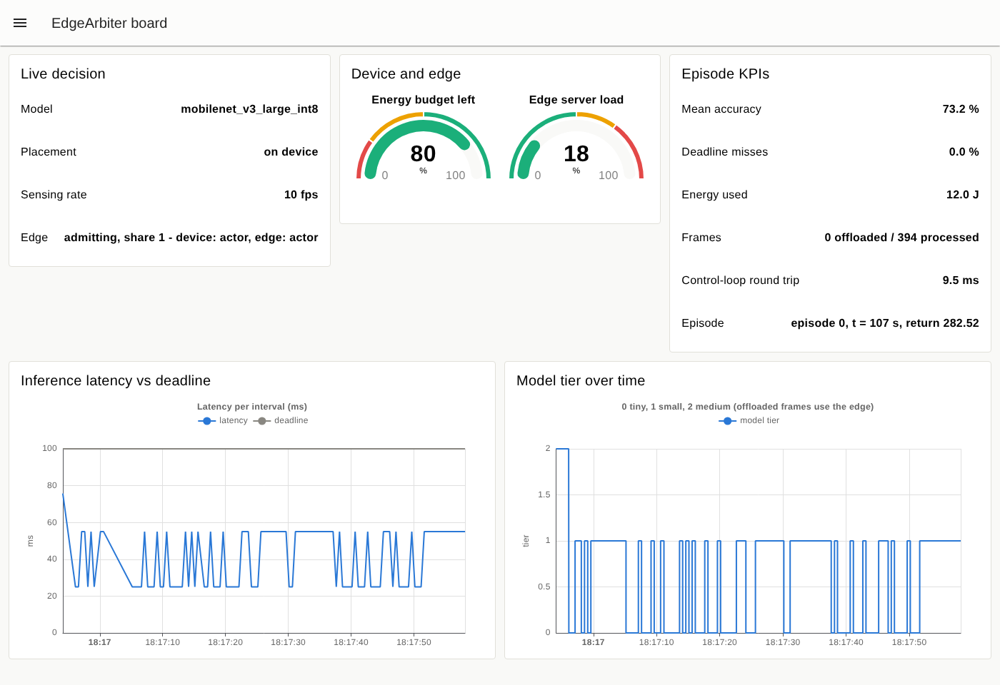
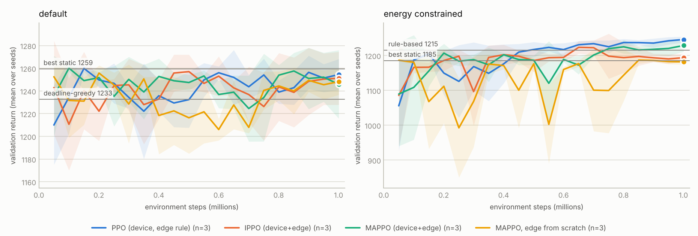

# EdgeArbiter — multi-agent RL for adaptive AI model selection on IoT-edge devices

[](https://github.com/louayakermi2816-gif/edgearbiter/actions/workflows/tests.yml)

Real-time AI on IoT devices has to trade **accuracy against latency, energy and
network quality**: which model to run, how often to sense, and whether to run it
on the device or offload it to an edge server — while the edge server has its
own load to protect. EdgeArbiter studies that decision in three layers:

1. **Measured cost profiles** — a PyTorch/torchvision benchmark of FP32 and INT8
   classifiers and a detector (MobileNetV3, ResNet-18, EfficientNet-B0, SSDLite)
   for top-1 accuracy, p50/p95 latency and model size, plus a supervised
   **training pipeline** (MobileNetV3-Small on Imagenette, fine-tuned or from scratch).
2. **An IoT-edge simulator** driven by those profiles: bursty workload, Markov
   wireless link with bandwidth-limited uplink, bounded device queue, energy
   budget, edge server with background tenants.
3. **Cooperative agents** — a *device* agent (model tier × sensing rate ×
   local/offload) and an *edge* agent (admit × CPU share) trained with
   **independent PPO (IPPO)** and **MAPPO** (centralised critic, decentralised
   execution), against static, rule-based and model-based baselines.

A **FastAPI** service runs both agents on telemetry from an **ESP32** node over
**MQTT**, and a **Node-RED** board closes the loop and shows the live choice.
Everything runs in software: a **virtual ESP32 node** (Python, same MQTT protocol as
the firmware) drives the simulator in real time, and the Arduino firmware runs in the
**Wokwi** ESP32 simulator — no hardware needed.

```
torchvision models ──benchmark.py──▶ cost table ──▶ simulator (sim/env.py) ◀── scenarios
                                                          │
                     baselines (static, rule, greedy) ◀───┼───▶ PPO / IPPO / MAPPO (agents/mappo.py)
                                                          │
virtual ESP32 node / Wokwi ──MQTT──▶ Node-RED ──HTTP──▶ FastAPI /policy/decide ──▶ Node-RED ──MQTT──▶ node
        (simulator + cost table)          (board)          (device + edge agents)
```

## Status (October 2026)

In development since September 2026. Every number below comes from a file in
[`results/`](results/) written by the scripts in this repository.

| Part | State |
|---|---|
| Simulator, baselines, IPPO / MAPPO, experiment protocol | done, tested (`pytest`, CI) |
| Multi-seed RL results (2 scenarios, 3 seeds) | done — [results/experiments.md](results/experiments.md) |
| Latency / size benchmark, FP32 vs INT8, 1 and 4 threads | measured on a 4-vCPU x86 VM — [results/benchmark_edge.md](results/benchmark_edge.md) |
| Imagenette training pipeline | validated: MobileNetV3-Small **from scratch 82.6 %** top-1 — [results/finetune_mobilenet_v3_small_scratch.md](results/finetune_mobilenet_v3_small_scratch.md) |
| Top-1 of the ImageNet-pretrained FP32/INT8 models; fine-tuning from ImageNet | **pending**: needs the torchvision weights (download.pytorch.org) |
| Device-side benchmark on the real IoT device → measured cost table | **pending** (the simulator uses the labelled synthetic table meanwhile) |
| FastAPI service | run and exercised over HTTP (decisions, edge admission, simulator) |
| Software IoT loop: virtual ESP32 node ↔ MQTT ↔ Node-RED board ↔ FastAPI | run end to end here with the trained MAPPO actors: 150 / 150 decisions answered through Node-RED, mean round trip 14.5 ms; MQTT loop tested in CI |
| ESP32 firmware in Wokwi; Docker stack | files ready; not run in the build environment (no Docker, no Arduino toolchain) |

## Quick start

```bash
python -m venv .venv && source .venv/bin/activate      # Windows: .venv\Scripts\activate
pip install -r requirements.txt && pip install -e .
pytest -q                                              # simulator, agents, benchmark, training loop, API

python scripts/run_baselines.py                        # static / rule-based / greedy baselines
python scripts/run_experiments.py --steps 1000000 --seeds 0 1 2 --workers 4   # PPO, IPPO, MAPPO, both scenarios (~1 h on 4 cores)
python scripts/run_benchmark.py --weights random --threads 1 4   # latency/size only, no weight download
python scripts/run_benchmark.py                        # + Imagenette top-1 with pretrained weights
python scripts/finetune_imagenette.py --epochs 5       # fine-tune from ImageNet weights
python scripts/finetune_imagenette.py --from-scratch --epochs 20 --lr 3e-3   # no download needed
uvicorn edgearbiter.api:app --reload                   # http://127.0.0.1:8000/docs
```

`train_single_agent.py` (PPO only) and `train_marl.py` (IPPO + MAPPO) run subsets
of the same protocol. The IoT loop without hardware is described [below](#the-iot-loop-in-software).

## The IoT loop in software



The board above is Node-RED (Dashboard 2.0) driven by the **virtual ESP32 node**
(`edgearbiter/virtual_node.py`) with the trained MAPPO actors answering in the API.
Each second the node publishes its telemetry (battery, queue, RTT, bandwidth, arrivals,
`seq`) on `edgearbiter/telemetry`; the flow adds the edge load, calls `/policy/decide`
and publishes the decision on `edgearbiter/decision`; the node runs that second of the
simulator with the decision (same cost table, link, workload and energy model as in
training) and publishes the outcome on `edgearbiter/node` for the board. A decision
that does not come back within the interval counts as a timeout and the node keeps the
last one, as the firmware does (the tiny model locally until the first decision arrives).

```bash
pip install -e ".[iot]"                                  # adds amqtt, a broker in Python
python -m edgearbiter.broker --port 1883 &               # or Mosquitto
MODEL_DEVICE=models/experiments/default/mappo_seed0_device.pt \
MODEL_EDGE=models/experiments/default/mappo_seed0_edge.pt uvicorn edgearbiter.api:app --port 8000 &
python -m edgearbiter.virtual_node --api http://localhost:8000 --steps 300   # node + policy, no Node-RED

# with the board (Node-RED >= 3 and @flowfuse/node-red-dashboard installed in ~/.node-red):
MQTT_HOST=localhost API_URL=http://localhost:8000 node-red node-red/flows.json   # http://localhost:1880/dashboard
python -m edgearbiter.virtual_node                       # waits for the decisions from Node-RED
```

`docker compose up --build` runs the same four parts (Mosquitto, API, Node-RED with the
dashboard, virtual node). The firmware (`firmware/esp32/edge_node/`) speaks the same
protocol and comes with a Wokwi project (`diagram.json`, `wokwi.toml`, `platformio.ini`):
it simulates frame arrivals and reads the battery level from a potentiometer, so the
policy's reaction to a draining battery can be watched in the simulator. For an RL
library, `edgearbiter.sim.DeviceEnv` exposes the device agent as a Gymnasium
environment (edge on its rule, passes `gymnasium.utils.env_checker.check_env`).

## The simulator

One step = one second. Frames arrive from a calm/busy workload (Poisson 2 or 9 fps)
and queue on the device (30 frames max; extra frames are dropped). The device
processes up to its sensing rate, locally or on the edge. Offloading costs the
link's RTT plus transfer time and is **throughput-limited by the uplink** (a 40 KB
frame at 0.8 Mbps → 2 frames/s). The edge serves background tenants whose load
follows a bounded random walk; reserving a CPU share for the device while the
server is busy slows them down. Latency, energy and accuracy come from the cost
table. Both agents act **simultaneously** each second; the edge's decision is its
admission policy for that interval.

| Agent | Observation (local) | Action |
|---|---|---|
| device | battery, queue, link state, RTT, bandwidth, arrivals, last violation rate, **edge's last admission decision (accepting, share)**, time | tier (3) × rate {1, 5, 10 fps} × placement {local, edge} = 18 |
| edge | own background load, last offload request / frames / requested tier, link state and queue reported by the device, time | admit {0, 1} × CPU share {0.5, 1.0} = 4 |

The device cannot read the server's load — it only sees what the edge publishes —
so the two agents have to coordinate through their actions. MAPPO's centralised
critic sees both observations during training only.

Shared reward per step:

`Σ accuracy(processed) − 0.5·violations − 0.5·energy_J − 0.3·dropped − 0.2·rejected − 0.5·share·ρ/(1−ρ)`

where the last term is the **edge congestion cost**: ρ/(1−ρ) is the M/M/1 backlog
of the background tenants at utilisation ρ, charged for the reserved share when it
is used. Without it, "always admit at full share" would be optimal and the edge
agent would have nothing to learn. A rejected offload falls back to the tiny model
locally (after a wasted round trip). The episode lasts 300 s or ends when the
energy budget is spent (penalty 20). Weights: `SimConfig` in `edgearbiter/sim/env.py`.

Scenarios (`edgearbiter/experiments.py`):

- `default` — 60 J energy budget per 300 s episode;
- `energy_constrained` — 40 J (~133 mW): the best local model no longer fits the
  budget at full rate, so a policy has to mix models, offloading and sensing rate.

## Learning

`edgearbiter/agents/mappo.py` implements PPO for the dict-based two-agent
environment, from scratch in PyTorch:

- **IPPO**: one actor and one critic per agent, each on its own observation;
- **MAPPO**: one actor per agent, one shared critic on the joint observation
  (centralised training, decentralised execution);
- **PPO (single agent)**: the device learns while the edge follows its fixed rule;
- choices following Yu et al., *The Surprising Effectiveness of PPO in Cooperative
  Multi-Agent Games* (2022): value-target normalisation, separate actor/critic
  optimisers and gradient clipping, lock-step vectorised environments (8),
  linear learning-rate annealing; γ = 0.995 because the energy budget spans the
  whole episode;
- **warm start of the edge from its rule**: trained jointly from random
  initialisation, the two agents tend to settle in a "nobody offloads"
  equilibrium (early on, random offloads look costly to the edge, the edge learns
  to reject, the device learns not to offload). IPPO and MAPPO therefore start the
  edge actor by behaviour cloning of the existing admission rule (near-deterministic)
  and then improve both agents jointly, with a small entropy bonus on the edge
  (0.001 vs 0.02 on the device): the edge's learning signal is weak because its
  action only matters when the device offloads, and a large entropy bonus drifts it
  back toward random rejections. `mappo_scratch` is the ablation without the warm start;
- these settings were chosen in short pilot runs scored on validation episodes only.
  What the pilots showed: with γ = 0.99 the agent under-weights running out of
  energy at the end of the episode; factorised policy heads (one per action
  factor, still available as `factorized=True`) explore offloading earlier but were
  less stable than one softmax over the 18 joint actions; evaluating the
  deterministic (argmax) policy is usually better than sampling, except right after
  the policy has learned to spend its budget, so each run keeps its best
  validation checkpoint.

Protocol: all methods are evaluated on the same 20 test episodes (seeds 1000+).
Learning curves, model selection (each run keeps its best validation checkpoint)
and the choice of the best static configuration use separate validation episodes
(seeds 50000+). Learned methods are trained with 3 seeds. Differences in return
are **paired** episode by episode against the best static policy, with 95 % CIs.

## Results

### Learning to arbitrate

All learning results below run on the labelled **synthetic cost table** (see Status);
the full tables with every KPI and the per-seed returns are in
[results/experiments.md](results/experiments.md).

<picture><source media="(prefers-color-scheme: dark)" srcset="results/experiments_learning_curves_dark.png"></picture>

Validation return during training (mean over 3 seeds, band ± std); horizontal lines are the
best static policy and the best heuristic on the same validation episodes.

Test results — 20 held-out episodes; learned methods pooled over 3 training seeds; Δ is the
paired per-episode difference to the best static policy (exhaustive search over the 18 fixed
device actions on validation episodes), with its 95 % CI:

**`energy_constrained`** — reference: best static policy: tiny 10fps local

| policy | test return | Δ vs best static (95 % CI) | accuracy | deadline misses | energy | offloaded frames |
|---|---|---|---|---|---|---|
| always_tiny_local | 640.1 | -397.7 ± 73.1 | 0.680 | 0.0 % | 17.6 J | 0 |
| always_offload_medium | 853.8 | -184.0 ± 42.5 | 0.787 | 33.0 % | 17.3 J | 1219 |
| rule_based | 1057.5 | +19.6 ± 10.6 | 0.725 | 2.0 % | 20.9 J | 523 |
| deadline_greedy | 1014.8 | -23.1 ± 49.2 | 0.773 | 10.0 % | 29.2 J | 858 |
| best static | 1037.8 | — | 0.680 | 0.0 % | 23.8 J | 0 |
| PPO (device, edge rule) | 1087.1 | +49.3 ± 7.4 | 0.740 | 2.0 % | 29.5 J | 496 |
| IPPO (device+edge) | 1087.2 | +49.4 ± 10.0 | 0.736 | 1.7 % | 30.8 J | 429 |
| MAPPO (device+edge) | 1084.4 | +46.5 ± 7.4 | 0.736 | 1.7 % | 29.6 J | 461 |
| MAPPO, edge from scratch | 1052.3 | +14.5 ± 6.2 | 0.701 | 0.0 % | 32.4 J | 0 |

**`default`** — reference: best static policy: small 10fps local

| policy | test return | Δ vs best static (95 % CI) | accuracy | deadline misses | energy | offloaded frames |
|---|---|---|---|---|---|---|
| always_tiny_local | 640.1 | -463.6 ± 73.0 | 0.680 | 0.0 % | 17.6 J | 0 |
| always_offload_medium | 853.8 | -249.9 ± 46.3 | 0.787 | 33.0 % | 17.3 J | 1219 |
| rule_based | 1057.5 | -46.3 ± 16.1 | 0.725 | 2.0 % | 20.9 J | 523 |
| deadline_greedy | 1065.4 | -38.3 ± 18.7 | 0.772 | 9.9 % | 30.7 J | 862 |
| best static | 1103.7 | — | 0.740 | 0.0 % | 49.6 J | 0 |
| PPO (device, edge rule) | 1109.2 | +5.5 ± 9.0 | 0.747 | 1.3 % | 38.8 J | 370 |
| IPPO (device+edge) | 1109.9 | +6.2 ± 7.5 | 0.750 | 1.1 % | 43.4 J | 271 |
| MAPPO (device+edge) | 1108.4 | +4.7 ± 9.6 | 0.748 | 1.2 % | 40.0 J | 353 |
| MAPPO, edge from scratch | 1102.0 | -1.7 ± 1.5 | 0.739 | 0.0 % | 49.1 J | 1 |

What the numbers say:

- **When the energy budget binds, learning pays off.** In `energy_constrained` the learned
  policies beat the best fixed configuration by +46.5 to +49.4 per episode (+4.5 to +4.8 %)
  and the rule-based heuristic by +26.9 to +29.8 (paired 95 % CIs ± 4.0–6.5). What they
  learned (`scripts/inspect_policy.py`): offload the medium model at 10 fps when the link is
  good and the edge admits (57 % of those intervals for PPO, 73 % for MAPPO, seed 0), and
  otherwise mix the INT8 small and the tiny model with lower sensing rates to stay within the
  energy budget — 429–496 offloaded frames per episode, deadline misses 1.7–2.0 %.
- **With a generous budget, a well-chosen fixed configuration is already near-optimal.** In
  `default` the INT8 small model locally at 10 fps is the best fixed policy; the learned
  policies tie it (+4.7 to +6.2, CIs of ± 7.5–9.6 that include zero) and beat both
  hand-written heuristics by 43–52.
- **Joint (multi-agent) training needs the warm start, and then matches the single agent.**
  With the edge learned from scratch, MAPPO converges to an edge that **never admits**
  (0.0 % of intervals in all three seeds), so the device never offloads and only gains
  +14.5 ± 6.2 from mixing local models. Warm-started edges admit in 71–86 % of intervals:
  IPPO then ties PPO-with-a-fixed-edge-rule (+0.1 ± 6.9) and MAPPO is marginally below it
  (−2.8 ± 2.4); IPPO's learned edge rejects far fewer offloads (4.9 vs 15.6 per episode)
  but the return is the same. In this simulator the threshold rule is already a good
  admission policy; settings where the edge holds more private information (several
  devices, unannounced load bursts) are where joint learning should matter — next step.
- **Pairing matters.** Episode returns vary by about ± 200 with the workload; paired
  differences have CIs of ± 2–10, which is what makes 20 test episodes × 3 seeds conclusive.

### Model benchmark (latency / size)

Measured 2026-10-23 on a cloud VM (Intel(R) Xeon(R) Processor @ 2.80GHz, 4 vCPU), torch 2.14.1+cu130, batch 1, p50 over 100 runs, random-init weights ([full table](results/benchmark_edge.md)).

| model | precision | input | p50, 1 thread | p50, 4 threads | size |
|---|---|---|---|---|---|
| mobilenet_v3_small | FP32 | 224 px | 11.9 ms | 13.9 ms | 10.3 MB |
| mobilenet_v3_large | FP32 | 224 px | 25.9 ms | 25.0 ms | 22.1 MB |
| mobilenet_v3_large_int8 | INT8 (qnnpack) | 224 px | 36.1 ms | 36.5 ms | 5.7 MB |
| resnet18 | FP32 | 224 px | 73.4 ms | 30.9 ms | 46.8 MB |
| resnet18_int8 | INT8 (fbgemm) | 224 px | 20.6 ms | 10.9 ms | 11.8 MB |
| efficientnet_b0 | FP32 | 224 px | 51.4 ms | 40.2 ms | 21.4 MB |
| ssdlite320_mobilenet_v3_large | FP32 | 320 px | 117.1 ms | 108.1 ms | 14.1 MB |

INT8 helps where the kernels are tuned for the CPU: ResNet-18 INT8 (fbgemm) is
3.6× faster than FP32 on one thread and 4× smaller. torchvision's INT8
MobileNetV3-Large is calibrated for **qnnpack** (ARM); on this x86 host it is
slower than FP32 while 4× smaller — on an ARM device the ranking is expected to
flip, which is exactly why the cost table has to be measured on the target. The
small MobileNetV3 models do not speed up with more threads at batch size 1.
Timings come from a shared cloud VM: run-to-run variation is about ±20 % (the same
model measured 9.4 and 12.2 ms at 4 threads in two runs a minute apart), so compare
models within one run and re-measure on the target hardware.

Weights were randomly initialised because download.pytorch.org is not reachable
from the build environment; latency and size depend only on the architecture
(see `edgearbiter/benchmark.py`). With network access, `python scripts/run_benchmark.py`
adds Imagenette top-1 for every pretrained model.

### Imagenette training

MobileNetV3-Small trained **from scratch** on Imagenette (160 px release, 128 px
input, 20 epochs, AdamW one-cycle, CPU only): **82.6 % top-1** on the 3,925
validation images ([results/finetune_mobilenet_v3_small_scratch.md](results/finetune_mobilenet_v3_small_scratch.md)).
This validates the data pipeline, augmentation, schedule and checkpointing on real
data and is the control for the fine-tuning run (ImageNet initialisation), which
needs the pretrained weights. Benchmarked as a tier, the trained checkpoint runs in
9.2 ms (1 thread) / 12.2 ms (4 threads) at 128 px and weighs 6.2 MB, with the
same 82.6 % recomputed by the benchmark
([results/benchmark_edge_imagenette.md](results/benchmark_edge_imagenette.md)). The first two
epochs sit at chance level while batch-norm statistics settle, then accuracy climbs steadily;
per-epoch times vary because the CPU was shared with other jobs.

## Layout

```
edgearbiter/costs.py          cost table (measured or labelled synthetic default)
edgearbiter/benchmark.py      latency / size / accuracy benchmark, INT8 variants, cost-table builder
edgearbiter/data.py           Imagenette loaders and the shared preprocessing
edgearbiter/finetune.py       MobileNetV3-Small training on Imagenette (ImageNet init or scratch)
edgearbiter/sim/link.py       link (incl. uplink throughput), workload, edge load, congestion
edgearbiter/sim/env.py        two-agent simulator, observation builders, edge rule
edgearbiter/agents/mappo.py   IPPO / MAPPO trainer (value norm, vectorised envs, warm start)
edgearbiter/baselines.py      static, rule-based and deadline-greedy policies
edgearbiter/evaluate.py       seeded evaluation, paired comparisons, tables
edgearbiter/experiments.py    scenarios, multi-seed training, model selection, report
edgearbiter/plots.py          learning curves (light / dark)
edgearbiter/sim/gym_env.py    Gymnasium wrapper of the device agent (DeviceEnv)
edgearbiter/api.py            FastAPI: /policy/decide, /infer, /sim/*
edgearbiter/virtual_node.py   virtual ESP32 node: MQTT telemetry -> decision -> simulated interval
edgearbiter/broker.py         MQTT broker in Python (amqtt), for running the loop without Mosquitto
firmware/esp32/edge_node/     ESP32 telemetry + decision node (Arduino) and its Wokwi project
node-red/flows.json           control loop (telemetry -> /policy/decide -> decision) and the board
scripts/                      run_benchmark, finetune_imagenette, run_baselines, run_experiments,
                              train_single_agent, train_marl, inspect_policy
tests/                        simulator, agents, benchmark, training loop, experiments, API, MQTT loop
```

## Limitations (known, on purpose)

- The simulator runs on a **synthetic cost table** until the benchmark is run on
  the device and the edge host (`--role device` / `--role edge`, then `--merge`).
- Energy per inference is derived from latency (`ENERGY_MJ_PER_MS`) until measured
  with a power meter.
- The detector is benchmarked for latency only (no COCO evaluation), and its
  random-weight latency is indicative (NMS work depends on the scores).
- Eager-mode INT8 (`torch.ao.quantization`) is deprecated upstream; it still ships
  with torch 2.14, the migration path is torchao.
- A physical device has no episode: for the firmware the API feeds `t_fraction` = 0 and
  the battery level as the remaining budget, an approximation of the training conditions
  (the virtual node reports both from its simulated episode).

## License

MIT — see `LICENSE`.
