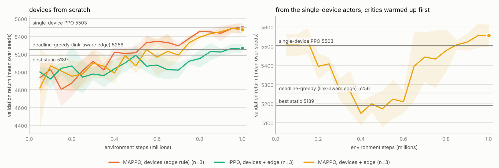

## fleet5

Cost table: `results/cost_table.json` (2a623037e244) · 3 seeds × 1,000,000 steps per run

<picture><source media="(prefers-color-scheme: dark)" srcset="fleet5_learning_curves_dark.png"></picture>

### 5 devices (near, mid, far, near, mid links) sharing one edge, battery 22.8 J per device per 300 s episode

Mean ± std over 20 test episodes (seeds 1000+; learned methods: pooled over 3 training seeds). Δ return: paired difference vs `best static medium 10fps local`, 95 % CI.

| policy | return | mean_accuracy | violation_rate | energy_j | dropped | offloaded | rejected | edge_cost | Δ return vs best static medium 10fps local |
|---|---|---|---|---|---|---|---|---|---|
| rule_based (edge rule) | 4904.3 ± 525.3 | 0.846 ± 0.006 | 0.056 ± 0.018 | 113.3 ± 2.0 | 54.4 ± 19.5 | 3004.8 ± 1025.5 | 8.8 ± 9.1 | 102.2 ± 27.8 | -304.4 ± 237.8 |
| deadline_greedy (edge rule) | 5298.5 ± 388.8 | 0.869 ± 0.001 | 0.240 ± 0.050 | 103.2 ± 5.1 | 720.4 ± 475.3 | 4577.9 ± 1354.0 | 16.1 ± 16.7 | 112.2 ± 30.8 | +89.8 ± 175.0 |
| deadline_greedy (link-aware edge) | 5504.0 ± 352.8 | 0.868 ± 0.000 | 0.061 ± 0.015 | 108.6 ± 3.1 | 1058.1 ± 448.0 | 3111.8 ± 921.9 | 39.8 ± 8.8 | 108.9 ± 29.5 | +295.3 ± 161.6 |
| best static medium 10fps local | 5208.7 ± 45.7 | 0.869 ± 0.000 | 0.000 ± 0.000 | 114.0 ± 1.0 | 3.4 ± 5.6 | 0.0 ± 0.0 | 0.0 ± 0.0 | 0.0 ± 0.0 | — |
| single-device PPO on each device (edge rule) | 5818.2 ± 319.5 | 0.867 ± 0.002 | 0.149 ± 0.040 | 107.9 ± 4.8 | 54.3 ± 55.7 | 4086.6 ± 1407.4 | 9.2 ± 10.3 | 105.1 ± 29.0 | +609.5 ± 78.5 |
| single-device PPO on each device (link-aware edge) | 5944.5 ± 338.2 | 0.867 ± 0.001 | 0.041 ± 0.013 | 111.4 ± 2.9 | 11.2 ± 10.7 | 2950.6 ± 990.8 | 22.8 ± 7.1 | 98.0 ± 27.4 | +735.9 ± 84.3 |
| MAPPO, devices (edge rule) | 5845.2 ± 377.3 | 0.866 ± 0.001 | 0.042 ± 0.017 | 111.3 ± 2.9 | 33.6 ± 18.1 | 2830.3 ± 1060.5 | 19.2 ± 22.8 | 99.9 ± 26.0 | +636.5 ± 95.0 |
| IPPO, devices + edge | 5524.2 ± 335.0 | 0.863 ± 0.004 | 0.041 ± 0.041 | 111.8 ± 3.0 | 44.2 ± 59.5 | 2058.5 ± 1273.6 | 56.9 ± 45.2 | 87.4 ± 47.5 | +315.6 ± 84.6 |
| MAPPO, devices + edge | 5801.4 ± 340.3 | 0.865 ± 0.002 | 0.033 ± 0.012 | 110.9 ± 2.9 | 36.3 ± 18.3 | 3027.3 ± 608.8 | 22.2 ± 30.9 | 236.8 ± 150.8 | +592.7 ± 85.2 |
| MAPPO, devices + edge, from single-device actors, critic warm-up | 5867.2 ± 310.2 | 0.866 ± 0.001 | 0.061 ± 0.041 | 110.0 ± 3.5 | 41.4 ± 49.1 | 3325.9 ± 1079.6 | 4.2 ± 6.5 | 176.1 ± 118.4 | +658.6 ± 77.2 |

Devices still running at the end of the episode (of 5):

| policy | alive |
|---|---|
| rule_based (edge rule) | 0.55 |
| deadline_greedy (edge rule) | 4.00 |
| deadline_greedy (link-aware edge) | 3.15 |
| best static medium 10fps local | 0.20 |
| single-device PPO on each device (edge rule) | 2.43 |
| single-device PPO on each device (link-aware edge) | 1.48 |
| MAPPO, devices (edge rule) | 1.48 |
| IPPO, devices + edge | 1.15 |
| MAPPO, devices + edge | 1.45 |
| MAPPO, devices + edge, from single-device actors, critic warm-up | 1.88 |

Test return per training seed (step of the selected checkpoint):

| method | seed 0 | seed 1 | seed 2 |
|---|---|---|---|
| MAPPO, devices (edge rule) | 5845.1 (checkpoint 1000k) | 5830.0 (checkpoint 851k) | 5860.6 (checkpoint 1000k) |
| IPPO, devices + edge | 5446.8 (checkpoint 950k) | 5405.0 (checkpoint 950k) | 5721.0 (checkpoint 201k) |
| MAPPO, devices + edge | 5771.7 (checkpoint 851k) | 5846.6 (checkpoint 1000k) | 5785.9 (checkpoint 950k) |
| MAPPO, devices + edge, from single-device actors, critic warm-up | 5928.9 (checkpoint 700k) | 5785.3 (checkpoint 950k) | 5887.4 (checkpoint 151k) |
